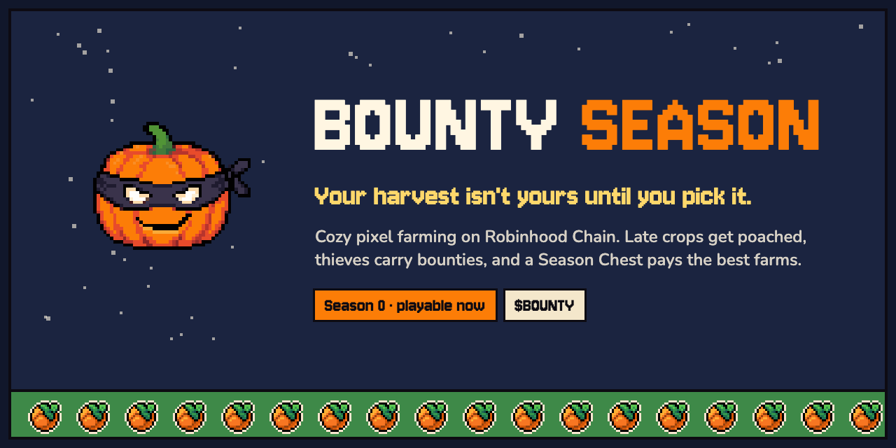
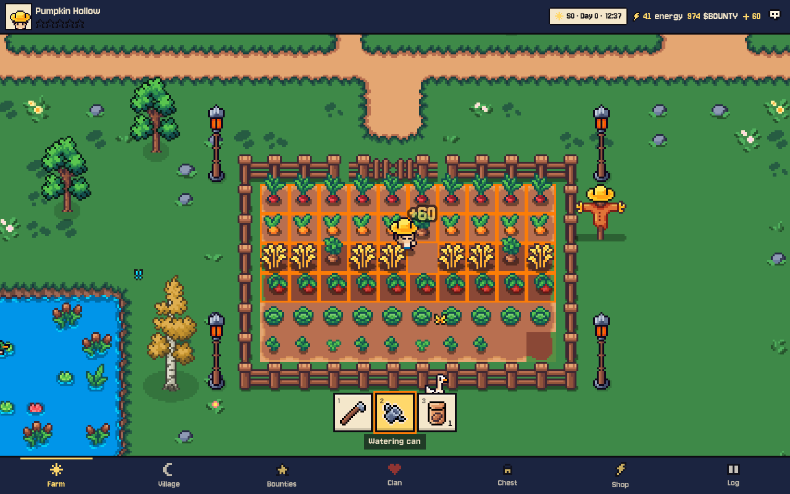
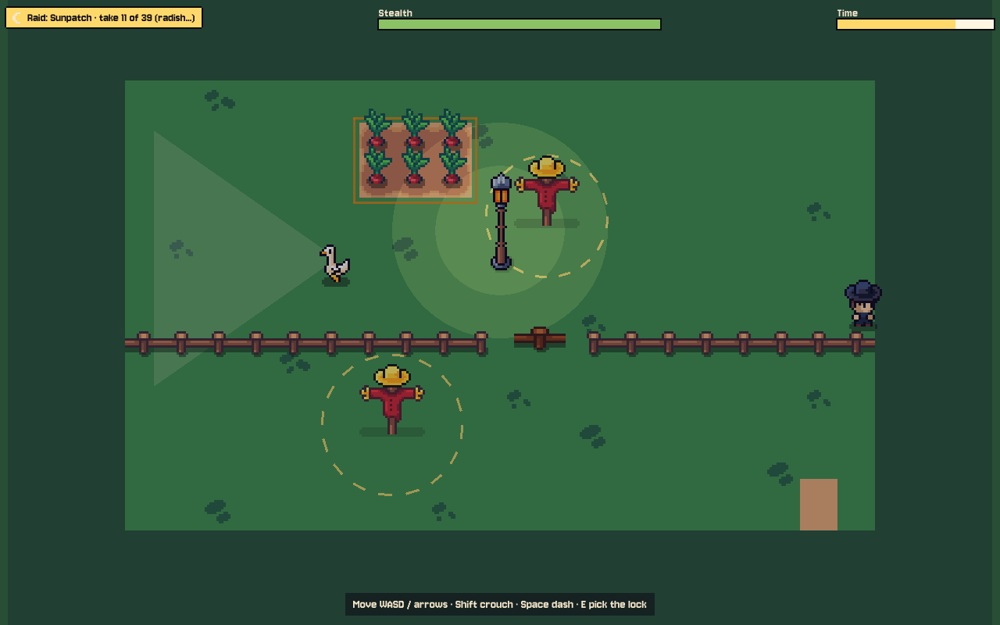
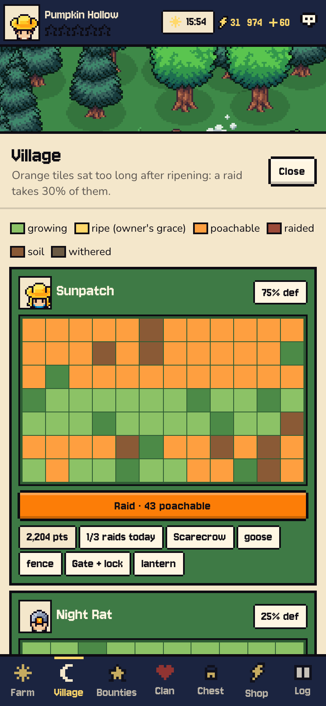
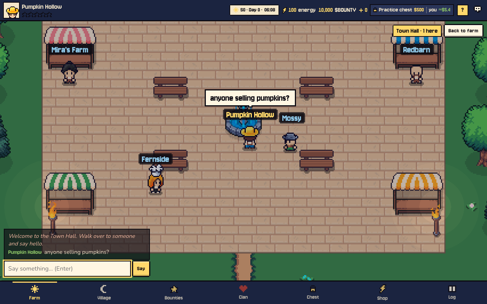
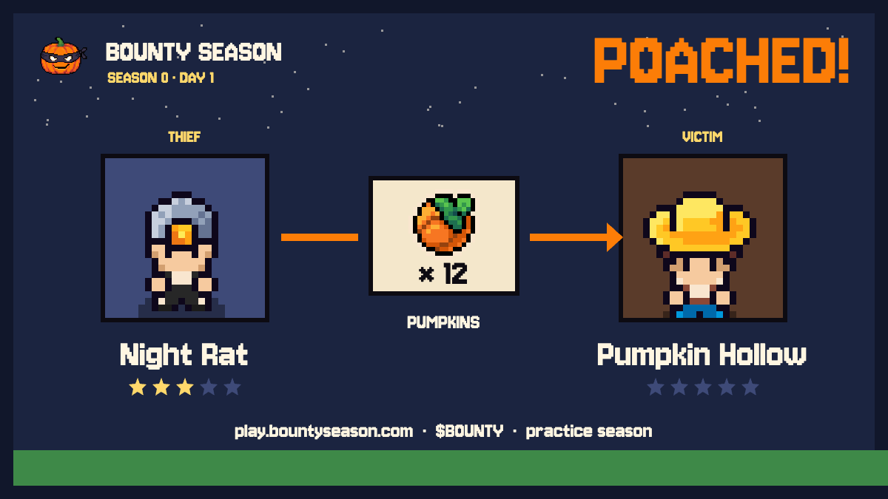
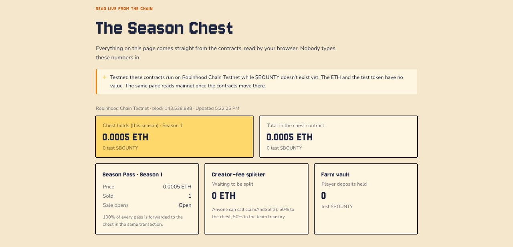
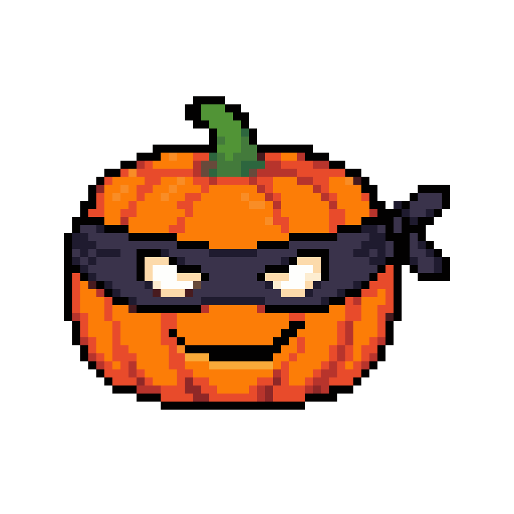

  

  
  
  
  

  <a href="https://play.bountyseason.com"><b>Play</b></a> ·
  <a href="https://bountyseason.com"><b>Website</b></a> ·
  <a href="https://bountyseason.com/docs"><b>Docs</b></a> ·
  <a href="https://bountyseason.com/chest"><b>Live chest</b></a> ·
  <a href="https://x.com/bountyRH"><b>@bountyRH</b></a>

---

## About

**Bounty Season** is a cozy pixel farming game on **Robinhood Chain** with a crime problem.

You farm like any farming game: hoe a tile, plant a seed, water it, pick it when it ripens. The difference is what happens when you don't. A ripe crop is yours alone for **30 minutes**. After that it glows on the village map, and any neighbor with energy can sneak past your goose and walk off with it.

Robbed? Put a **$BOUNTY** on the thief. Every **14 days** the season ends and a **Season Chest** pays the top farms, clans and bounty hunters.

> People don't share their crop totals. They share the night someone stole their pumpkins, and the bounty that got the thief back. Theft gives a farm stakes, stakes give players stories, and stories travel.

The economy is built the other way round from faucet-style farming games:

- **No faucet.** The Season Chest is filled by what players spend and by half of the creator fee, and it can never pay out more than it holds.
- **One payday.** Claims open once, when the season locks, not every day.
- **Half of all spending burns.** The other half goes back to players through the chest.
- **The server decides.** The browser sends inputs, never results; every raid is replayed and scored on the server.

**Season 0** is a free practice season: no token needed, a practice balance, and a team-funded practice chest. The game comes first, the token after.

---

## Features

### 🌱 Your farm, tile by tile

- Walk your farm with **WASD**, the arrow keys or a touch stick on phones
- **Hoe, water, plant and pick** per tile, or drag across many tiles to queue the work in order
- **8 crops** from radish (30 minutes) to pumpkin (24 hours): short crops score more per hour, long crops more per pick
- Watering and fertilizer speed a crop up; every crop you pick gives its seed back
- Buy more land to grow the field, feed the coop for extra Harvest Score

### 🕐 The ripeness clock

Every crop runs on one server clock, so nothing in the browser can fake it.

| State | How long | Who can pick it |
|---|---|---|
| **Growing** | 30 min to 24 h | nobody yet |
| **Ripe** | 30 minutes | only you (the grace window) |
| **Poachable** | 6 hours | any neighbor, one raid per ripening |
| **Withered** | | nobody: the crop is lost |

### 🥷 The sneak: raiding a neighbor

A raid is a **10-second sneak** across the target's farm. Stay out of the guard goose's sight cone, slip past the scarecrows' noise zones, find the gap in the fence and tap the lock on the gate.

- **Success** takes 30% of the farm's poachable crops, and they count toward your Harvest Score
- **Caught** means the goose honks, the owner gets an alert and you gain a Wanted star
- Success chance = **run score × (1 − defence rating)**, with defences capped at **75%**: no farm is untouchable and no raid is free
- Single-use raid tokens that expire in 30 seconds; the server replays your inputs and refuses runs faster than they were played

### 🪿 Defences

| Defence | Rating | Lasts |
|---|---|---|
| Guard goose | 30% | the season |
| Gate + lock | 20% | the season |
| Scarecrow | 15% | 7 days |
| Wooden fence | 10% | the season |
| Night lantern | 10% | 3 days |
| Watchman | 10% | 1 day |

Clan members' geese cover each other's fields on **night watch**.

### ⭐ The Bounty Board

<table>
  <tr>
    <td width="38%"></td>
    <td>

Every theft creates a target.

- Robbed farmers post a **bounty** on the thief, held in escrow for 24 hours
- Any player who raids the thief's farm inside the window collects **90%** of it
- Bounties **stack**: three victims put three rewards on one head
- **Wanted stars** make a capture worth more, from ×1.0 at one star to ×2.0 at five
- A **1-hour revenge raid** at half the energy, a **24-hour Sprout Shield** for new farms
- The **village map** shows every neighbor's field: what's growing, what's ripe, what's poachable

</td>
  </tr>
</table>

### 🏛️ The Town Hall

Your farm is yours alone. The Town Hall is where everyone meets.

- A **live multiplayer square**: see every farmer who's online walk around in real time
- **Chat** with bubbles over heads and a chat log (links and wallet addresses are refused)
- **Barn market** at the stalls: trade crops with other players
- The **bounty board** and your neighbors from the valley

### 🃏 Share cards

Every poach and every capture becomes a **Poached!** or **Captured!** card with both farm names, drawn from the game's own art. Share it straight from your phone, or save it and post it.

### 📦 The Season Chest, live on chain

[bountyseason.com/chest](https://bountyseason.com/chest) reads the contracts straight from your browser and refreshes every 30 seconds: what the chest holds, Season Pass sales, fees waiting to be split, every deposit with its transaction link.

| Where the money goes | Split |
|---|---|
| **Season Pass** ($2 in ETH) | 100% to the Season Chest, in the same transaction |
| **In-game spending** | 50% burned, 50% to the chest |
| **Bounty fee** (10%) | half burned, half to the chest |
| **Creator fee** from trading | 50% to the chest, 50% to the team, split by contract |

| Chest at the lock | Share |
|---|---|
| Top 100 farms | 60% (rank *r* weighs 1 / r^0.8) |
| Top clans | 25% |
| Bounty hunters | 10% |
| Next season | 5% |

### 🔐 Wallet sign-in and the Season Pass

- **Sign in with a wallet**: a signature only, no transaction, no gas. One farm per wallet, and the same farm opens on any device
- Guests can still play Season 0 and link a wallet later without losing progress
- **Season Pass on chain**: buy it from the Chest tab; your wallet sends the purchase itself and the game reads the pass from the contract. Live on **Robinhood Chain testnet** today

### 🏆 Clans, titles and badges

- **Clans** of up to 20 farmers; the clan score is everyone's Harvest Score, and top clans share 25% of the chest
- **Sheriff track** for hunters: Deputy at 3 captures, Sheriff at 10, Marshal of the Valley for the most
- **Badges** like Green Thumb, Night Owl, Goose Whisperer, Most Wanted and Big Game Hunter
- Titles, badges and clans carry over from season to season

### 🛡️ Fair play

- Server-authoritative timers, raids and scores
- Rate limits on actions per minute
- A Sprout Shield on every new farm, and at most 3 raids on the same farm a day
- $BOUNTY buys time, reach, protection and style. Every raid is still won on the sneak.

---

## On chain

| Contract | What it does |
|---|---|
| **SeasonPass** | One pass per wallet per season; forwards 100% of the price to the chest |
| **SeasonChest** | Holds each season's ETH and $BOUNTY, commits a daily leaderboard hash, pays out through a timelocked Merkle root |
| **FarmVault** | Holds player deposits; settles spending as 50% burn, 50% chest; withdrawals with daily caps and a circuit breaker |
| **FeeSplitter** | The launchpad's creator-fee recipient: anyone can trigger the 50/50 split |

Two guardians can pause a contract for 72 hours (the pause ends by itself), every admin change waits 24 hours in a public timelock, and nobody can move chest funds except through a timelocked payout root.

The contracts are live on **Robinhood Chain testnet** while **$BOUNTY** is pre-launch. $BOUNTY launches as a fair launch with a fixed supply of 1,000,000,000, **0% team allocation** and no presale.

---

   
  <b>Plant something. Leave it a little too long. See who shows up.</b> 
  <a href="https://play.bountyseason.com">play.bountyseason.com</a>

Bounty Season is a game. Season Chest rewards depend on final rankings and on what the chest holds when a season ends; nothing is promised. Nothing here is financial advice. $BOUNTY is a utility token for use inside the game. Poaching, bounties and theft exist only inside the game. Bounty Season is an independent project and is not affiliated with Robinhood Markets, Inc. or with any launchpad.
